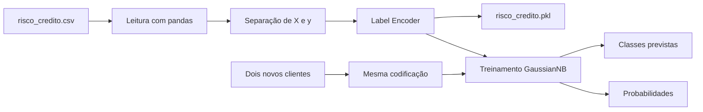

# Documentação detalhada do código

## 1. Objetivo do projeto

O projeto utiliza aprendizagem de máquina para classificar o risco de crédito de um cliente em uma das seguintes classes:

- `alto`;
- `baixo`;
- `moderado`.

A base contém informações categóricas sobre 14 clientes. Cada registro possui quatro atributos de entrada e uma classe de saída:

| Coluna | Função | Valores possíveis |
|---|---|---|
| `historia` | Histórico de crédito | `boa`, `desconhecida`, `ruim` |
| `divida` | Nível da dívida | `alta`, `baixa` |
| `garantias` | Existência de garantias | `adequada`, `nenhuma` |
| `renda` | Faixa de renda | `0_15`, `15_35`, `acima_35` |
| `risco` | Classe que será prevista | `alto`, `baixo`, `moderado` |

O algoritmo escolhido foi o **Gaussian Naïve Bayes**, conforme solicitado no enunciado. Após o treinamento, o programa prevê o risco de dois novos clientes.

## 2. Fluxo geral



É importante aplicar aos novos clientes exatamente os mesmos codificadores ajustados com a base de treinamento. Caso códigos diferentes fossem utilizados, o modelo interpretaria os dados de forma incorreta.

## 3. Importação das bibliotecas

```python
from pathlib import Path
import pickle

import numpy as np
import pandas as pd
from sklearn.naive_bayes import GaussianNB
from sklearn.preprocessing import LabelEncoder
```

Função de cada biblioteca:

- `pathlib.Path`: cria caminhos de arquivos de maneira independente do sistema operacional;
- `pickle`: salva objetos Python em formato binário;
- `numpy`: trabalha com matrizes numéricas;
- `pandas`: lê o CSV e organiza os dados em tabelas;
- `LabelEncoder`: converte categorias textuais em números;
- `GaussianNB`: implementa o classificador Gaussian Naïve Bayes.

## 4. Definição dos caminhos

```python
PASTA_PROJETO = Path(__file__).resolve().parent
CAMINHO_CSV = PASTA_PROJETO / "risco_credito.csv"
CAMINHO_PKL = PASTA_PROJETO / "risco_credito.pkl"
```

`__file__` representa o arquivo Python atual. O método `resolve()` obtém seu caminho absoluto, e `parent` seleciona a pasta que contém o script.

Essa abordagem evita depender da pasta em que o terminal foi aberto. Assim, o programa encontra `risco_credito.csv` desde que ele esteja ao lado do script.

## 5. Função de criação do Label Encoder

```python
def criar_encoder(valores):
    encoder = LabelEncoder()
    valores_codificados = encoder.fit_transform(valores)
    return encoder, valores_codificados
```

A função executa duas operações:

1. `fit`: identifica as categorias existentes e aprende o mapeamento;
2. `transform`: substitui cada categoria pelo código numérico correspondente.

O método `fit_transform` combina as duas operações. A função devolve tanto o codificador ajustado quanto os dados transformados. Guardar o codificador é necessário para transformar corretamente os novos clientes.

Cada coluna recebe um `LabelEncoder` diferente. Não se deve usar um único mapeamento para atributos com significados distintos.

## 6. Função que exibe os mapeamentos

```python
def exibir_mapeamento(nome, encoder):
    mapeamento = {
        categoria: int(codigo)
        for categoria, codigo in zip(
            encoder.classes_, encoder.transform(encoder.classes_)
        )
    }
    print(f"{nome}: {mapeamento}")
```

`encoder.classes_` contém as categorias aprendidas, normalmente em ordem alfabética. O `zip` associa cada categoria ao número criado pelo codificador.

Os mapeamentos obtidos são:

| Atributo | Mapeamento |
|---|---|
| `historia` | `boa = 0`, `desconhecida = 1`, `ruim = 2` |
| `divida` | `alta = 0`, `baixa = 1` |
| `garantias` | `adequada = 0`, `nenhuma = 1` |
| `renda` | `0_15 = 0`, `15_35 = 1`, `acima_35 = 2` |

Esses números são apenas representações das categorias. Com exceção da faixa de renda, não devem ser interpretados automaticamente como uma escala matemática.

## 7. Função principal

```python
def main():
```

A função `main` concentra o fluxo do programa. Isso melhora a organização e permite importar o arquivo em outro programa sem executar imediatamente todo o processamento.

### 7.1. Verificação do CSV

```python
if not CAMINHO_CSV.exists():
    raise FileNotFoundError(
        "O arquivo risco_credito.csv deve estar na mesma pasta deste script."
    )
```

Antes da leitura, o programa verifica se o arquivo existe. Se estiver ausente, é gerado um erro com uma mensagem clara, em vez de continuar com dados inexistentes.

### 7.2. Leitura dos dados

```python
dataset_risco_credito = pd.read_csv(CAMINHO_CSV)
```

`pd.read_csv` lê o arquivo e cria um `DataFrame`, estrutura tabular do pandas formada por linhas e colunas.

Em seguida, o código apresenta:

- todos os registros da base;
- quantidade de linhas e colunas;
- quantidade de valores ausentes por coluna;
- distribuição da variável `risco`.

A base possui 14 linhas, 5 colunas e nenhum valor ausente. A distribuição das classes é:

| Classe | Quantidade |
|---|---:|
| `alto` | 6 |
| `baixo` | 5 |
| `moderado` | 3 |

Essa verificação permite conhecer a base antes de construir o modelo e perceber que a classe `moderado` possui menos exemplos.

## 8. Separação dos atributos e da classe

```python
X_risco_credito = dataset_risco_credito.iloc[:, 0:4].values
y_risco_credito = dataset_risco_credito.iloc[:, 4].values
```

Por convenção:

- `X` representa os atributos utilizados para fazer a previsão;
- `y` representa a resposta correta, também chamada de alvo ou classe.

O `iloc` seleciona dados pela posição:

- `:` seleciona todas as linhas;
- `0:4` seleciona as colunas de índice 0 a 3;
- `4` seleciona somente a quinta coluna.

O atributo `.values` converte os dados do pandas em arrays NumPy. Os formatos resultantes são:

- `X_risco_credito`: `(14, 4)`, ou seja, 14 clientes e 4 atributos;
- `y_risco_credito`: `(14,)`, ou seja, uma classe para cada cliente.

## 9. Codificação dos atributos categóricos

O processo é repetido para cada coluna:

```python
label_encoder_historia, X_risco_credito[:, 0] = criar_encoder(
    X_risco_credito[:, 0]
)
```

São criados quatro codificadores independentes:

- `label_encoder_historia`;
- `label_encoder_divida`;
- `label_encoder_garantias`;
- `label_encoder_renda`.

Após a transformação, o comando abaixo garante que a matriz possua tipo inteiro:

```python
X_risco_credito = X_risco_credito.astype(int)
```

Um novo `DataFrame` é criado apenas para exibir a base já codificada de forma legível. A variável `y_risco_credito` continua textual, pois o `GaussianNB` aceita rótulos de classe em formato de texto.

## 10. Salvamento com Pickle

```python
with CAMINHO_PKL.open("wb") as arquivo:
    pickle.dump([X_risco_credito, y_risco_credito], arquivo)
```

O modo `wb` significa *write binary*, ou escrita binária. O arquivo armazena uma lista com:

1. a matriz de atributos codificados;
2. o vetor de classes.

O `with` fecha o arquivo automaticamente após a escrita. O formato Pickle é específico do Python e deve ser carregado somente quando sua origem for confiável, pois arquivos Pickle desconhecidos podem executar conteúdo malicioso durante a leitura.

## 11. Criação e treinamento do modelo

```python
naiveb_risco_credito = GaussianNB()
naiveb_risco_credito.fit(X_risco_credito, y_risco_credito)
```

O primeiro comando cria o classificador. O método `fit` realiza o treinamento utilizando:

- os atributos numéricos em `X_risco_credito`;
- as respostas conhecidas em `y_risco_credito`.

O Naïve Bayes utiliza o Teorema de Bayes:

\[
P(C \mid X) = \frac{P(X \mid C) \cdot P(C)}{P(X)}
\]

Onde:

- `C` é uma classe de risco;
- `X` é o conjunto de características do cliente;
- `P(C)` é a probabilidade inicial da classe;
- `P(X|C)` é a probabilidade de observar os atributos quando a classe é conhecida;
- `P(C|X)` é a probabilidade da classe após observar os atributos.

O termo *naïve* vem da hipótese simplificadora de que os atributos são condicionalmente independentes quando a classe é conhecida. O modelo Gaussiano estima uma distribuição normal para cada atributo dentro de cada classe.

## 12. Preparação dos novos clientes

Os casos solicitados são:

1. história boa, dívida alta, nenhuma garantia e renda acima de 35;
2. história ruim, dívida alta, garantia adequada e renda de 0 a 15.

O código não digita manualmente os números dos atributos. Ele reutiliza os encoders:

```python
label_encoder_historia.transform(["boa"])[0]
```

Essa prática reduz o risco de informar um código incorreto. A matriz final dos novos clientes é:

```text
cliente i  = [0, 0, 1, 2]
cliente ii = [2, 0, 0, 0]
```

## 13. Previsões e probabilidades

```python
previsoes = naiveb_risco_credito.predict(novos_clientes)
probabilidades = naiveb_risco_credito.predict_proba(novos_clientes)
```

- `predict` retorna a classe escolhida pelo modelo;
- `predict_proba` retorna a probabilidade estimada de cada classe.

Resultados:

| Cliente | Previsão | P(alto) | P(baixo) | P(moderado) |
|---|---|---:|---:|---:|
| i | `baixo` | 0,065874 | 0,934122 | 0,000004 |
| ii | `moderado` | 0,000000 | 0,000000 | 1,000000 |

As probabilidades podem aparecer com pequenas diferenças nas últimas casas decimais dependendo da versão das bibliotecas. A classe prevista é aquela que possui a maior probabilidade estimada.

## 14. Classes aprendidas e contagem

```python
naiveb_risco_credito.classes_
naiveb_risco_credito.class_count_
```

O atributo `classes_` apresenta as classes conhecidas pelo modelo:

```text
['alto', 'baixo', 'moderado']
```

O atributo `class_count_` mostra quantos registros foram usados em cada classe, seguindo a mesma ordem:

```text
[6., 5., 3.]
```

## 15. Controle de execução

```python
if __name__ == "__main__":
    main()
```

Quando o arquivo é executado diretamente, a variável especial `__name__` recebe o valor `"__main__"`, e a função principal é chamada.

Quando o arquivo é importado por outro módulo, `main()` não é chamado automaticamente. Isso torna o código reutilizável e mais fácil de testar.

## 16. Limitações e cuidados metodológicos

### Base pequena

A base contém somente 14 registros. Ela é adequada para demonstrar as etapas do algoritmo, mas não é suficiente para construir um sistema real de decisão de crédito.

### Ausência de conjunto de teste

O exercício utiliza todos os registros para treinar o modelo e depois classifica dois casos fornecidos. Portanto, o projeto não mede métricas como acurácia, precisão ou recall em dados separados.

Não é correto afirmar que o modelo possui determinada acurácia sem realizar uma avaliação apropriada. Em um projeto maior, seria necessário separar treino e teste ou aplicar validação cruzada.

### Label Encoder e variáveis categóricas

O `LabelEncoder` atribui números às categorias. No Gaussian Naïve Bayes, esses números são tratados como valores quantitativos e modelados por distribuições normais. Essa é uma simplificação adotada no exercício.

Para uma aplicação real com atributos puramente categóricos, seria importante avaliar modelos como `CategoricalNB` ou utilizar outra estratégia de codificação e comparar o desempenho.

### Independência dos atributos

O Naïve Bayes supõe independência condicional entre os atributos. Na prática, informações como renda e dívida podem estar relacionadas. Mesmo com essa simplificação, o algoritmo costuma ser útil como modelo inicial por ser rápido e fácil de interpretar.

### Uso responsável

Uma decisão real de crédito pode afetar diretamente uma pessoa. Um sistema desse tipo precisaria de uma base representativa, auditoria de vieses, explicabilidade, segurança, privacidade e supervisão humana.

## 17. Resumo final

O código executa o seguinte processo:

1. lê e inspeciona o CSV;
2. separa os atributos da classe;
3. transforma categorias em números;
4. salva os dados pré-processados;
5. treina o Gaussian Naïve Bayes;
6. codifica dois novos clientes com os mesmos mapeamentos;
7. calcula classes e probabilidades;
8. apresenta as previsões `baixo` e `moderado`.

O principal aprendizado do projeto é compreender todo o fluxo de uma solução simples de aprendizagem de máquina, desde o pré-processamento até a interpretação do resultado.
